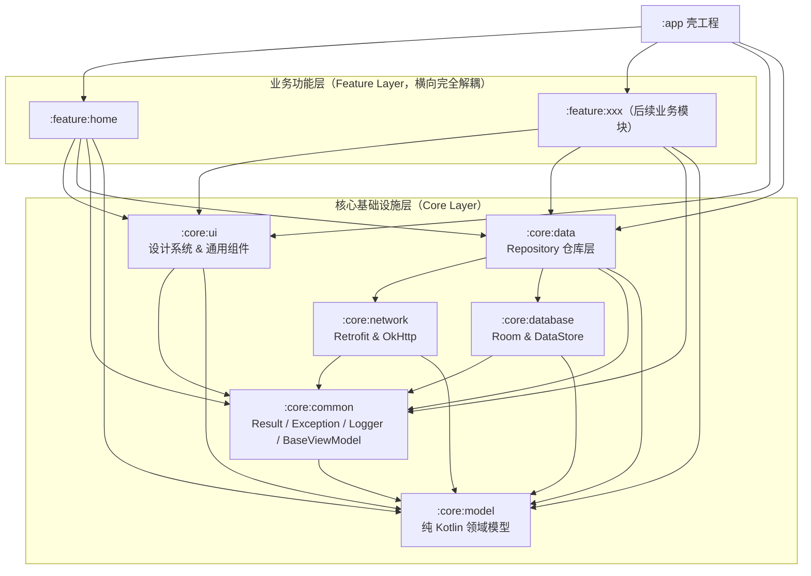
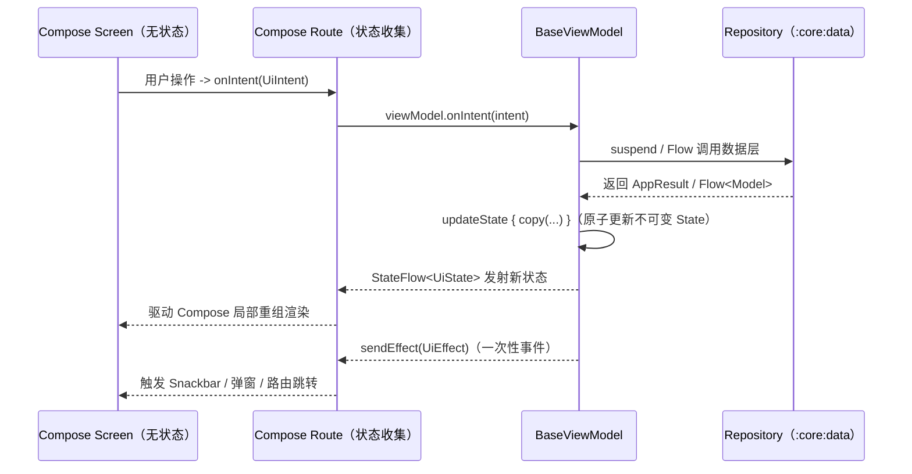

# 架构设计文档（Architecture Guide）

本文档阐述 `StandardDemo` 企业级 Android 框架的整体分层设计、模块依赖边界、数据流模型及核心基础设施设计原则。

---

## 1. 分层模块化依赖图

本项目遵循 Google 官方推荐的 **Clean Architecture + 多模块按功能/层次拆分** 架构。依赖方向严格单向向下，**严禁循环依赖与跨层越权访问**。

### 模块依赖红线（Code Review 必查）
1. **禁止 Feature 互相依赖**：`:feature:a` 不得依赖 `:feature:b`。跨模块页面跳转统一通过 `:app` 的 `AppNavHost` 注入导航回调完成；跨模块共享的领域模型下沉至 `:core:model`，共享的业务逻辑下沉至 `:core:data` 或 `:core:domain`。
2. **禁止 Feature 直接依赖网络或数据库模块**：`:feature:*` 只能依赖 `:core:data` 暴露的 `Repository` 接口，严禁直接注入 `Retrofit ApiService` 或 `Room Dao`。
3. **保持 `:core:model` 纯净**：`:core:model` 为纯 JVM Kotlin 模块，不得引入 `android.*`、`androidx.room.*`、`retrofit2.*` 等重型框架注解。

---

## 2. 表现层架构：MVI / 单向数据流（UDF）

所有业务页面统一继承 `:core:common` 中的 `BaseViewModel<S : UiState, I : UiIntent, E : UiEffect>`，确保状态变化完全可预测、可追溯、易单测。

### 三要素职责划分
- **`UiState`（持久状态）**：使用 `@Immutable data class` 表示当前页面完整渲染快照，通过 `StateFlow` 暴露。旋转屏幕或配置变更后状态自动保留。
- **`UiIntent`（用户意图）**：使用 `sealed interface` 穷举页面发出的所有操作（如点击、下拉刷新、输入变更），由 `ViewModel.onIntent()` 统一收敛处理。
- **`UiEffect`（一次性副作用）**：使用 `Channel(Channel.BUFFERED)` 发送，仅消费一次（如弹出 Snackbar、关闭弹窗、页面跳转），避免使用 `StateFlow` 导致屏幕旋转后重复弹出提示。

### Route 与 Screen 分离原则
- **`XxxRoute`（有状态入口）**：负责 `hiltViewModel()` 获取、`collectAsStateWithLifecycle()` 收集状态、`LaunchedEffect` 消费 `uiEffect`。
- **`XxxScreen`（无状态渲染）**：仅接收 `uiState` 与 `onIntent` Lambda，不持有 `ViewModel` 实例。因此可直接编写 `@Preview` 和无依赖 Compose UI 测试。

---

## 3. 数据层架构：离线优先与单一可信源

在 `:core:data` 中，推荐对列表与核心业务数据采用 **Offline-First（离线优先 / Single Source of Truth）** 架构：

1. **读路径**：`Repository.observeXxx()` 始终从 Room DAO 返回 `Flow<List<DomainModel>>`，UI 层持续监听该流。
2. **写/同步路径**：`Repository.syncXxx()` 在注入的 `@Dispatcher(AppDispatchers.IO)` 调度器上通过 `safeApiResponseCall` 调用远程接口，成功后将数据映射为 Entity 写入 Room。
3. **自动联动**：Room 写入成功后自动触发 `observeXxx()` 发射最新数据，UI 无感刷新，即使在弱网或离线状态下也能秒开历史数据。

---

## 4. 统一错误处理与结果封装体系

| 层级 | 组件 | 职责 |
| --- | --- | --- |
| 网络层 | `ApiResponse<T>` | 校验后端统一业务 `code`，非成功码或空数据时抛出 `BusinessException` / `UnauthorizedException` |
| 网络层 | `safeApiCall` / `safeApiResponseCall` | 捕获超时、断网、HTTP 状态码、JSON 序列化错误，统一转换为 `AppResult.Error(AppException)` |
| 公共层 | `AppException`（密封类） | 隔离底层异常堆栈与用户可读文案（`userMessage`），支持按类型精准分发 UI 处理 |
| 公共层 | `AppResult<T>` | 在数据层与表现层间显式传递 `Loading` / `Success` / `Error`，杜绝静默吞异常 |
| 表现层 | `BaseViewModel.launchSafely` | 统一兜底协程异常日志，严格透传 `CancellationException` 保护结构化并发 |

---

## 5. 导航架构：Jetpack Navigation 3 + Hilt 自动聚合

本项目全面采用 **Jetpack Navigation 3** 实现声明式、可控回退栈的多模块导航：
- **状态驱动回退栈（`NavigationState` + `Navigator`）**：定义在 `:core:ui` 中，使用 `rememberNavBackStack` 与 `rememberSerializable` 自动跨配置变更与进程重建持久化，原生支持多顶级 Tab 独立回退栈。
- **作用域化装饰器**：`NavigationState.toEntries()` 默认挂载 `rememberSaveableStateHolderNavEntryDecorator` 与 `rememberViewModelStoreNavEntryDecorator`，保证每个页面拥有独立的 UI 状态恢复与 `ViewModelStore` 生命周期。
- **零侵入多模块路由注册**：各 `:feature:*` 模块通过 `@Module @InstallIn(ActivityRetainedComponent::class)` + `@IntoSet` 贡献 `EntryProviderInstaller`，由 `:app` 的 `MainActivity` 注入并传入 `AppNavHost`（底层为 `NavDisplay`），新增业务模块无需修改壳工程路由表。
- **弹窗与自适应场景扩展**：`AppNavHost` 默认启用 `DialogSceneStrategy`，后续适配平板/折叠屏时可直接叠加 Material 3 Adaptive `SceneStrategy`（如 List-Detail / Supporting Pane）。

---

## 6. 依赖注入策略（Hilt + KSP）

- **全量 KSP**：项目基于 AGP 9 内置 Kotlin，全面使用 KSP 替代已被淘汰的 kapt，大幅缩短编译耗时。
- **配置解耦**：`:app` 的 `AppConfigModule` 将 `BuildConfig` 中的多环境参数包装为 `AppConfig` 和 `NetworkConfig` 注入容器；下层模块通过接口或纯数据模型消费配置，无需反向依赖 `:app`。
- **资源复用**：`StandardApplication` 实现 Coil 3 `SingletonImageLoader.Factory`，通过 `dagger.Lazy<OkHttpClient>` 延迟复用网络层单例 `OkHttpClient`，避免冷启动主线程开销。
- **调度器可测试性**：所有协程调度器通过 `@Dispatcher(AppDispatchers.IO / DEFAULT / MAIN)` 注入，严禁在代码中硬编码 `Dispatchers.IO`。
